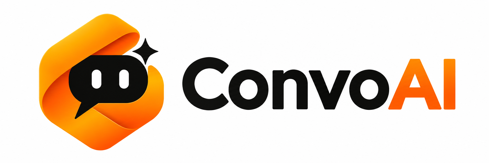

<div align="center">

  <picture>
    <source media="(prefers-color-scheme: dark)" srcset="assets/logo-primary-dark.png">
    <source media="(prefers-color-scheme: light)" srcset="assets/logo-primary-light.png">
    
  </picture>

  <br/>

  <h3>Conversations that remember. Intelligence that feels personal.</h3>

  <p>
    An AI-powered conversational assistant built with
    <strong>Google Gemini</strong>, <strong>FastAPI</strong>,
    <strong>Python</strong> and <strong>SQLite</strong>.
  </p>

  <br/>

  <a href="https://www.python.org/">
    
  </a>
  <a href="https://fastapi.tiangolo.com/">
    
  </a>
  <a href="https://ai.google.dev/">
    
  </a>
  <a href="https://www.sqlite.org/">
    
  </a>

  <br/>

  <a href="https://developer.mozilla.org/en-US/docs/Web/HTML">
    
  </a>
  <a href="https://developer.mozilla.org/en-US/docs/Web/CSS">
    
  </a>
  <a href="https://developer.mozilla.org/en-US/docs/Web/JavaScript">
    
  </a>
  <a href="https://github.com/pavankammila/ConvoAI">
    
  </a>

  <br/><br/>

  [**✨ Overview**](#-overview) &nbsp;•&nbsp;
  [**🚀 Features**](#-features) &nbsp;•&nbsp;
  [**🧱 Architecture**](#-architecture) &nbsp;•&nbsp;
  [**⚙️ Getting Started**](#️-getting-started) &nbsp;•&nbsp;
  [**🔌 API**](#-api-endpoints) &nbsp;•&nbsp;
  [**🧪 Testing**](#-testing)

</div>

---

## ✨ Overview

**ConvoAI** is a full-stack AI chat application designed to make conversations with a large language model feel **continuous and reliable**.

Powered by Google's Gemini API, ConvoAI keeps context across multiple turns, stores conversation history in SQLite, and manages long conversations through **context compaction**. When summarization is unavailable, the chat engine gracefully falls back to retaining a recent portion of the conversation.

The project pairs a Python backend with a browser-based chat interface and serves as a practical implementation of real-world LLM application concepts.

---

## 🚀 Features

<table>
  <tr>
    <td width="50%" valign="top">
      <h3>🤖 Gemini-powered responses</h3>
      Connects to Google's Gemini model through the Google Gen AI SDK.
    </td>
    <td width="50%" valign="top">
      <h3>💬 Multi-turn conversations</h3>
      Sends conversation history so replies can use earlier messages as context.
    </td>
  </tr>
  <tr>
    <td width="50%" valign="top">
      <h3>💾 Persistent chat history</h3>
      Stores conversations and messages in SQLite.
    </td>
    <td width="50%" valign="top">
      <h3>🔄 Conversation restoration</h3>
      Loads saved context when an existing conversation is continued.
    </td>
  </tr>
  <tr>
    <td width="50%" valign="top">
      <h3>🪟 Context window management</h3>
      Keeps the active conversation within a configurable history limit.
    </td>
    <td width="50%" valign="top">
      <h3>🧠 Conversation summarization</h3>
      Summarizes older messages to preserve useful context while retaining recent turns.
    </td>
  </tr>
  <tr>
    <td width="50%" valign="top">
      <h3>🛟 Graceful fallback</h3>
      Uses recent-message truncation if summarization fails.
    </td>
    <td width="50%" valign="top">
      <h3>🛡️ Error handling</h3>
      Provides a structured application error path for failures.
    </td>
  </tr>
  <tr>
    <td width="50%" valign="top">
      <h3>🎛️ Configurable settings</h3>
      Reads model and context settings from environment variables.
    </td>
    <td width="50%" valign="top">
      <h3>🌗 Responsive chat interface</h3>
      Dark, black-and-orange visual identity with a light/dark theme toggle.
    </td>
  </tr>
</table>

---

## 🧱 Architecture

ConvoAI cleanly separates the API layer, conversation orchestration, model integration and persistence.

```text
Browser
  │
  ▼
FastAPI application (main.py)
  │
  ▼
Chat engine (chat_engine.py)
  ├── Context management
  ├── Conversation history
  ├── Summarization / truncation
  │
  ├──────────────► Gemini client (llm_client.py)
  │                    │
  │                    ▼
  │               Google Gemini API
  │
  ▼
SQLite database (database.py)
  ├── Conversations
  └── Messages
```

### 📁 Project Structure

```text
ConvoAI/
├── assets/
│   ├── Glossy Orange Chat Loop Emblem.png
│   ├── Rounded Orange Chat Ribbon Logo.png
│   ├── logo-black.png
│   ├── logo-outline.png
│   ├── logo-primary-dark.png
│   └── logo-primary-light.png
│
├── static/
│   └── index.html
│
├── main.py
├── chat_engine.py
├── llm_client.py
├── database.py
├── errors.py
│
├── test_gemini.py
├── test_chat_engine.py
├── test_context.py
├── test_fallback.py
├── test_database.py
├── test_persistence.py
│
├── .env.example
├── .gitignore
└── README.md
```

---

## 🧰 Technology Stack

The project combines a Python-based backend, Google's Gemini API, SQLite persistence and a lightweight browser interface.

<div align="center">

  <h3>Core Technologies</h3>

  <a href="https://www.python.org/">
    
  </a>
  <a href="https://fastapi.tiangolo.com/">
    
  </a>
  <a href="https://ai.google.dev/">
    
  </a>
  <a href="https://www.sqlite.org/">
    
  </a>

  <br/>

  <h3>Frontend Technologies</h3>

  <a href="https://developer.mozilla.org/en-US/docs/Web/HTML">
    
  </a>
  <a href="https://developer.mozilla.org/en-US/docs/Web/CSS">
    
  </a>
  <a href="https://developer.mozilla.org/en-US/docs/Web/JavaScript">
    
  </a>
  <a href="https://github.com/pavankammila/ConvoAI">
    
  </a>

</div>

### Stack Details

| | Layer | Technology | Purpose |
|:-:|---|---|---|
| 🐍 | **Language** | Python | Backend implementation |
| ⚡ | **API framework** | FastAPI | HTTP API and application server |
| ✨ | **LLM** | Google Gemini | Natural-language generation |
| 🧩 | **SDK** | Google Gen AI SDK | Gemini API communication |
| 🗄️ | **Database** | SQLite | Persistent conversations and messages |
| 🔐 | **Configuration** | python-dotenv | Load local environment variables |
| 🎨 | **Frontend** | HTML, CSS, JavaScript | Chat user interface |
| 🚀 | **Dev server** | Uvicorn | Run the FastAPI application |
| 🐙 | **Version control** | GitHub | Source code hosting |

---

## ⚙️ Getting Started

### Prerequisites

- 🐍 **Python 3.10+** (developed and tested with Python 3.13)
- 🔑 A **Google Gemini API key**
- 🌿 **Git**

### 1️⃣ Clone the Repository

```bash
git clone https://github.com/pavankammila/ConvoAI.git
cd ConvoAI
```

### 2️⃣ Create and Activate a Virtual Environment

**Windows PowerShell**

```powershell
python -m venv venv
.\venv\Scripts\Activate.ps1
```

**macOS / Linux**

```bash
python3 -m venv venv
source venv/bin/activate
```

### 3️⃣ Install Dependencies

```bash
pip install fastapi uvicorn google-genai python-dotenv
```

### 4️⃣ Configure Environment Variables

Copy `.env.example` to `.env`.

**Windows PowerShell**

```powershell
Copy-Item .env.example .env
```

**macOS / Linux**

```bash
cp .env.example .env
```

Open `.env` and add your own Gemini API key and configuration:

```env
GEMINI_API_KEY=your_gemini_api_key
GEMINI_MODEL=your_model_name
MAX_HISTORY=12
KEEP_RECENT=6
REQUEST_TIMEOUT=30
```

| Variable | Description |
|---|---|
| `GEMINI_API_KEY` | Your Google Gemini API key |
| `GEMINI_MODEL` | The Gemini model name to use |
| `MAX_HISTORY` | Maximum messages kept before compaction is triggered |
| `KEEP_RECENT` | Number of recent messages retained after compaction |
| `REQUEST_TIMEOUT` | Timeout for model requests, in seconds |

> [!WARNING]
> **Security:** Never commit `.env` or share your API key. The repository's `.gitignore` excludes local environment files and SQLite database files. Keep `.env.example` free of real credentials.

### 5️⃣ Run the Application

```bash
python -m uvicorn main:app --reload
```

Then open:

| | Destination | URL |
|:-:|---|---|
| 💬 | **Chat interface** | http://127.0.0.1:8000 |
| 📖 | **API documentation** | http://127.0.0.1:8000/docs |
| ❤️ | **Health endpoint** | http://127.0.0.1:8000/health |

The SQLite database is initialized by the application and stores conversation data locally.

---

## 🔌 API Endpoints

| Method | Endpoint | Purpose |
|---|---|---|
|  | `/` | Serve the chat interface |
|  | `/api` | API information |
|  | `/health` | Health check |
|  | `/api/chat` | Send a message to a conversation |
|  | `/api/reset` | Reset conversation state |
|  | `/api/conversations` | List saved conversations |
|  | `/api/conversations/{conversation_id}` | Retrieve a saved conversation |
|  | `/api/conversations/{conversation_id}` | Delete a conversation |

Interactive request and response schemas are available at `/docs` while the server is running.

---

## 🧠 How Conversation Memory Works

ConvoAI maintains a separate message history for each conversation.

| Step | What happens |
|:-:|---|
| **1** | A user sends a message with a conversation ID. |
| **2** | The chat engine loads or creates the corresponding conversation. |
| **3** | The new message is added to the active history. |
| **4** | If the history exceeds the configured limit, older messages are compacted. |
| **5** | The engine attempts to summarize older context and retains recent messages. |
| **6** | If summarization fails, the engine falls back to retaining recent messages. |
| **7** | The Gemini client generates a response using the available context. |
| **8** | The updated conversation state is saved to SQLite. |

This approach balances **continuity**, **context size** and **resilience**.

---

## 🧪 Testing

The project includes tests for its core behavior. Run them from the project root with the virtual environment activated:

```bash
python -m py_compile main.py chat_engine.py database.py llm_client.py errors.py

python test_database.py
python test_chat_engine.py
python test_context.py
python test_fallback.py
python test_persistence.py
```

To test connectivity with the live Gemini API:

```bash
python test_gemini.py
```

> [!NOTE]
> The live API test requires a valid API key and available model quota. Provider-side rate limits or temporary service errors can affect this test independently of the local unit tests.

---

## 🔐 Security Notes

- 🔑 Store credentials in `.env`, not in source code.
- 🚫 Do not commit `.env`, API keys, local databases or virtual environments.
- 📝 Use `.env.example` to document required configuration without including secrets.
- ☁️ Before deploying publicly, configure secrets in the hosting provider's environment settings.
- 🛡️ Review CORS, authentication, rate limiting and data-retention requirements before exposing the service to public users.

---

## 🗺️ Roadmap

- [ ] ☁️ Deploy the application to a cloud hosting platform
- [ ] 👤 Add user authentication and per-user conversation ownership
- [ ] ⚡ Add streaming responses
- [ ] 🔎 Improve conversation search and organization
- [ ] 🎭 Add configurable assistant personalities
- [ ] 🧪 Add automated API and frontend integration tests
- [ ] 🚦 Add usage limits and rate limiting for public deployments

---

## 🤝 Contributing

Contributions, suggestions and bug reports are welcome.

1. 🍴 Fork the repository.
2. 🌱 Create a feature branch: `git checkout -b feature/your-feature`
3. 💾 Commit your changes: `git commit -m "Add your feature"`
4. 📤 Push the branch: `git push origin feature/your-feature`
5. 🔀 Open a pull request.

---

## 👨‍💻 Author

<div align="center">

  <h3>Pavan Kumar</h3>

  B.Tech Computer Science & Engineering — AI & ML

  <br/>

  <a href="https://github.com/pavankammila">
    
  </a>

</div>

---

## 📄 License

No license has been added to this repository yet. Until a license is selected, reuse and redistribution are not automatically permitted. Add a license file if you want to grant others explicit permissions.

---

<div align="center">

  <picture>
    <source media="(prefers-color-scheme: dark)" srcset="assets/logo-primary-dark.png">
    <source media="(prefers-color-scheme: light)" srcset="assets/logo-primary-light.png">
    
  </picture>

  <br/>

  **Built with curiosity, code, and Gemini.**

  ⭐ If you find ConvoAI interesting, consider starring the repository.

  <br/>

  © 2026 ConvoAI · Built by Pavan Kumar

</div>
